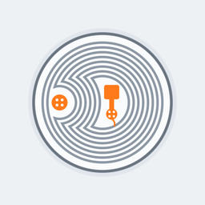

# FliBuddy



FliBuddy is a spool reader for 3D printing filament on a **Flipper Zero**.
Hold the NFC tag of a Bambu Lab spool (or an NTAG tag) to the back of the
Flipper and it shows the material, the color by Bambu's name and code, the
diameter, the label weight and the temperatures, with no phone and no
network.

With the FliBuddy app for **iPhone and iPad** and its **Apple Watch**
companion, the Flipper also keeps your own
[Bambuddy](https://github.com/maziggy/bambuddy) filament inventory up to
date: look a spool up, add new spools, record weighings from an ordinary
kitchen scale, link a tag to a spool and browse the inventory. A Mac app
exists for development and is not distributed.

Project page, privacy policy and support:
<https://sokogen.github.io/flipperzero-flibuddy/>

## What you need

- A Flipper Zero on the current official firmware release (**1.5.1** at
  the time of writing).
- For the phone apps: iOS, iPadOS and watchOS 26.
- For syncing: a Bambuddy server in internal inventory mode (Spoolman mode
  is not supported), reachable over **HTTPS**, and an API key with
  inventory read and update and settings read.

## Install

- **Flipper app:** Flipper Apps Catalog, category NFC. Coming soon.
- **iPhone, iPad and Apple Watch:** App Store. Coming soon.
- **From source:** see "Flipper app" and "Installing on an iPhone, iPad or
  Apple Watch" below.

## Privacy

FliBuddy collects no data: no accounts, analytics, tracking or ads. Settings
stay on your devices (the API key in the iOS Keychain) and data goes only
between your devices and your own Bambuddy server. See the
[privacy policy](https://sokogen.github.io/flipperzero-flibuddy/privacy/).
Help: [support](https://sokogen.github.io/flipperzero-flibuddy/support/) or
the [issue tracker](https://github.com/sokogen/flipperzero-flibuddy/issues).

## License and disclaimer

MIT, see [LICENSE](LICENSE). The apps are English only in 1.0.

FliBuddy is an independent project. It is not affiliated with, endorsed by
or sponsored by Bambu Lab, Flipper Devices or Bambuddy.

## For developers

Pointers: `AGENTS.md` (rules for contributors and agents), `host/README.md`
(Swift package, apps, logging), `flipper/README.md` (the FAP),
`tools/README.md` (icons, fixtures, bridge) and `protocol/PROTOCOL.md`. The
rest of this file is the technical overview.

### Overview

FliBuddy keeps a [Bambuddy](https://github.com/maziggy/bambuddy) filament
inventory accurate with a Flipper Zero instead of SpoolBuddy hardware. The
Flipper reads a spool's NFC tag (Bambu MIFARE Classic or NTAG) and streams
the raw dump over USB or Bluetooth LE to a host app on the Mac, an iPhone,
an iPad or an Apple Watch; the host parses the tag, looks the spool up in
Bambuddy, and records weights typed in from an ordinary kitchen scale, on
either the Flipper or the host. New spools can be created and existing ones
linked to a tag; from the Flipper a spool can also be marked new, marked
empty (archived) or deleted. See
`docs/superpowers/specs/2026-10-25-flipper-spoolbuddy-design.md`; the
Flipper screens are in `docs/design/flipper-ui-spec.md`, the Mac window in
`docs/design/macos-ui-spec.md`, the iPhone, iPad and Apple Watch apps in
`docs/design/ios-ui-spec.md`, `docs/design/ipados-ui-spec.md` and
`docs/design/watchos-ui-spec.md`.

FliBuddy, not SpoolBuddy: SpoolBuddy is Bambuddy's own kiosk device. The
project was renamed on 2026-10-26; the design spec keeps its old file name.

Bambuddy must run in internal inventory mode; the host refuses Spoolman
mode.

The iPhone, iPad, Apple Watch and Mac apps are English-only in 1.0; grams
show without a grouping separator (`1000 g`), as on the Flipper.

## Layout

```
LICENSE                   MIT
docs/superpowers/specs/   design docs
docs/design/              UI specs (Flipper, Mac, iPhone, iPad, watch)
docs/plans/               implementation plans
site/                     the GitHub Pages site: landing, privacy, support
protocol/                 PROTOCOL.md, JSON schema, fixtures (tag dumps,
                          sample messages) shared by all test suites
flipper/                  the FAP: application.fam, src/, host-compiled
                          unit tests in tests/
host/                     Swift package: FliBuddyCore library,
                          FliBuddyUI shared SwiftUI views,
                          FliBuddyMac SwiftUI executable, tests
host/Apple/               XcodeGen project.yml for the iPhone/iPad app
                          (iOS/) and its Apple Watch companion (Watch/),
                          Base.xcconfig, Signing.example.xcconfig
tools/                    Python dev bridge (Phase 0 spike, kept as a
                          debugging tool), fixture and icon generators,
                          simulator screenshot scripts
.github/workflows/        flipper, host and tools CI, path-filtered
```

Each part has its own README with the details: `flipper/README.md`,
`host/README.md`, `tools/README.md`, and the wire protocol in
`protocol/PROTOCOL.md`.

## Requirements

- Flipper Zero on firmware release **1.5.1** (stock, no fork).
- macOS 14+ with the Command Line Tools (Swift 6). The Mac host and the
  tests build with `swift build` / `swift test` only.
- For the iPhone, iPad and Watch apps: Xcode (iOS and watchOS 26 SDKs) and
  [XcodeGen](https://github.com/yonaskolb/XcodeGen) (`brew install
  xcodegen`). The devices need iOS/iPadOS 26 and watchOS 26.
- Python 3.13 and [uv](https://docs.astral.sh/uv/) for the bridge and the
  tools.
- [ufbt](https://pypi.org/project/ufbt/) for the Flipper app:

  ```
  uv tool install ufbt          # or: python3 -m pip install --upgrade ufbt
  ```

If Xcode.app is installed but its license is not accepted, `git`, `swift`
and `cc` from `/usr/bin` exit with 69. Prefix the commands below with
`DEVELOPER_DIR=/Library/Developer/CommandLineTools` (see `AGENTS.md`).

## Flipper app

```
cd flipper
ufbt dotenv_create            # once; flipper/.env keeps the SDK in flipper/.ufbt
ufbt update --branch=1.5.1    # once
ufbt                          # builds dist/flibuddy.fap
ufbt launch                   # builds, installs and starts it over USB
```

While the app uses USB (Connection USB, or Auto, the default) it owns the
USB serial port, so qFlipper and the Flipper CLI are unavailable until you
leave it. The app opens on **Waiting for app** (`USB: no app`) and turns to
**Ready** once an app has said hello; Bluetooth is described below. OK
there opens **Get app**, a QR code of the project page. Without an app a
scan shows what the tag itself carries.

▶ opens the Flipper's **Settings**: Connection (Auto / USB / Bluetooth),
**Auto-save new** (default Off), After scan (Show / Weigh), Weigh as
(Gross / Net), Feedback (Vibro+LED / LED / Off) and Sound.
With Auto-save new on, the host creates a scanned Bambu tag that Bambuddy
does not know at once ("Added to Bambuddy"); off, the tag shows "Not in
Bambuddy" and nothing is created until **Add** on the Flipper or **New** on
the host, which adds it at its label weight. See `flipper/README.md`.

The Flipper and the hosts speak protocol version 2
(`protocol/PROTOCOL.md`) and ship together: a peer on another version is
ignored, and the Mac status bar says so ("Flipper speaks protocol 1, host
speaks 2"), with what to update in its tooltip.

## Mac host

```
cd host
swift run FliBuddyMac
```

Open Settings (⌘,), enter the Bambuddy URL (`http://<BAMBUDDY_LAN_IP>:8000`;
the Mac accepts plain http, the iPhone, iPad and Watch only https)
and an API key with inventory read + update and settings read, pick the
empty-spool catalog entry for new items, and press **Test connection**. The
Flipper port defaults to the first `/dev/cu.usbmodemflip_*`. Every scan
appears in the session feed, where the weight can be entered or corrected,
new spools created and tags linked to existing spools. See `host/README.md`.

The app logs to `~/Library/Logs/FliBuddy/flibuddy.log` (Help ▸ **Show Log
File**); `FLIBUDDY_LOG=debug swift run FliBuddyMac` adds the protocol lines.
See "Debugging" in `host/README.md`.

The core weight of new items defaults to 242 g: everything on the scale that
is not filament, a Bambu reusable spool (215 g) plus a refill core (27 g).
Picking a catalog entry copies its weight, which can then be edited; the
entry is recorded only as `core_weight_catalog_id`. A core weight saved
before keeps its value, so an install set up with 250 g needs 242 entered
once. AMS-added spools take their core weight from the first "Bambu Lab"
catalog entry in Bambuddy, so set that entry to 242 g too.

## Phase 2: Bluetooth, iPhone, iPad and Apple Watch

The transport is a setting on both sides; nothing negotiates it.

- Flipper: Settings → **Connection**, **Auto** (the default), **USB** or
  **Bluetooth**. The choice is saved in `/ext/apps_data/flibuddy/settings.bin`;
  Auto starts both backends and the first app to say hello wins, USB or
  Bluetooth alone starts that one (with Bluetooth the USB port stays with
  the CLI and qFlipper). The Waiting screen shows `Visible as <name>` while
  advertising, and Ready follows once an app has said hello. See
  `flipper/README.md`.
- Host: Settings → Connection. The Mac offers USB and Bluetooth (USB stays
  the default); the iPhone, iPad and Watch use Bluetooth only. **Scan for
  Flipper** lists the Flippers nearby by name; the chosen one is
  remembered and reconnected to directly. **Forget** clears it. On the Mac
  every Settings change takes effect on **Save**; the iPhone and iPad apply
  each change at once.
- The iPhone and iPad keep the Flipper connected while the screen is locked
  (`bluetooth-central` background mode): a scan wakes the app, which
  answers the Flipper and calls Bambuddy inside a background task. If iOS
  ends the app in the background, it relaunches it for the next Bluetooth
  event (state restoration). A swiped-away app stays closed until opened.
  The Watch app works only while it is on screen.

There is no pairing step anywhere. The FAP publishes its own GATT service
instead of the stock serial profile, whose passkey prompt watchOS cannot
show, and the link is unencrypted: it carries tag dumps and grams, never
the API key. To try "just works" pairing, build the FAP with
`FLIBUDDY_BLE_REQUIRE_ENCRYPTION=1` (add
`cdefines=["FLIBUDDY_BLE_REQUIRE_ENCRYPTION=1"]` to
`flipper/application.fam`), which makes the characteristics require an
encrypted link.

While FliBuddy holds the Flipper's Bluetooth, the official Flipper mobile
app cannot connect; leaving the app restores the default profile.

### Installing on an iPhone, iPad or Apple Watch

To run the apps from Xcode with free provisioning (a personal team; the
install expires after 7 days and has to be repeated):

```
cp host/Apple/Signing.example.xcconfig host/Apple/Signing.xcconfig
# set DEVELOPMENT_TEAM in it (Xcode → Settings → Accounts shows the team ID)
make apple-project            # generates host/Apple/FliBuddy.xcodeproj
open host/Apple/FliBuddy.xcodeproj
```

Run the `FliBuddyiOS` scheme on the device. The watch app is embedded in
the iPhone app and installs from the Watch app on the phone. The bundle
ids (`com.sokolachko.flibuddy`, `….watchkitapp`) are placeholders; a free
team may need them changed to something unique.

In the iOS Settings, **Scan QR code** reads the QR code Bambuddy shows when
an API key is created and fills in the URL and the key (on devices with a
camera that supports it; typing stays the fallback) and starts **Test
connection**. The Watch has no settings of its own beyond the Flipper: half
a second after each change applied on the iPhone (and once at launch), the
phone pushes the Bambuddy URL, API key, core weight, catalog entry and
default mode to the watch over WatchConnectivity. The watch keeps them,
shows them read-only and talks to Bambuddy itself. On the watch the weight
is entered with the Digital Crown, and a row waiting for a weight opens on
its own (a row not in Bambuddy or just added does not: **Weigh again**
opens the crown entry). The watch saves weights and adds a new spool in one
tap (**New**, at its label weight) from a tag that carries its material;
other tags are created, and tags linked
to an existing spool, on the iPhone, iPad or Mac. The iPad has no watch to
sync to.

The iPhone shows the feed as cards with a connection banner at the top,
in portrait only. An iPad shows the feed as tiles, three to a row on a 13"
iPad and two on an 11": in landscape beside a sidebar with both
connections, in portrait under a top tab bar and the banner; a narrow
multitasking window gets the iPhone's cards. ⌘S, ⌘↑ / ⌘↓, ⌘⌫ and ⌘, are
menu commands. On
every host, Net/Gross converts the number on screen, the color line
carries Bambu's color code, and the technical tag facts (UID, tray UUID,
filament id, diameter, nozzle range) sit in **Tag details**, a row's
context menu on the Mac, iPhone and iPad and the row detail on the watch.
See `host/README.md`.

### Apple builds

```
make apple-project            # xcodegen generate in host/Apple
make apple-build              # FliBuddyiOS and FliBuddyWatch for the
                              # simulators, CODE_SIGNING_ALLOWED=NO
```

Both need Xcode, not the Command Line Tools. The project is generated, not
checked in (`host/Apple/*.xcodeproj` and `Signing.xcconfig` are
git-ignored); CI runs the same two targets. `make apple-archive` builds the
signed App Store export; `-FliBuddyDemo YES` runs the apps on demo
fixtures, which `tools/sim_shot.sh` and `tools/store_shots.sh` capture. See
`host/README.md`.

## Python dev bridge

The bridge does what the Mac host does from a terminal, for the Phase 0
spike and for debugging the protocol:

```
cd tools
uv run python -m bridge --bambuddy http://<BAMBUDDY_LAN_IP>:8000 --api-key bb_...
uv run python -m bridge               # no Bambuddy: print the parsed scans only
```

`--port` overrides the auto-detected `/dev/cu.usbmodemflip_*`; the key can
also come from `$BAMBUDDY_API_KEY`; `--core-weight` (default 242 g, see the
Mac host above) and `--catalog-id` set the core weight and the catalog entry
of new items. Only one program can hold the port: quit the
Mac host before starting the bridge.

## Fixtures

`protocol/fixtures/` is the contract shared by the C, Swift and Python
suites:

- `messages/`: one sample per message type, status and action, validated
  against `protocol/schema/message.schema.json`; the C encoder output must
  equal them once JSON whitespace is stripped.
- `tags/`: tag dumps. `bambu_pla_pure_real.json` is a real Bambu tag
  (spool "PLA Pure", UID `7EF1AB04`) captured by the bridge in Phase 0,
  marked `synthetic: false`; it was read with sectors 3-15 missing, which
  still covers every field the parsers use (blocks 1-10). Every parser
  and the Flipper's classifier and `scan` encoder are tested against it.
  `bambu_pla_basic_synthetic.json` is built from the documented block
  layout (`synthetic: true`) and stays for the key vectors, the sample
  messages and the full 16-sector cases; `ntag215_blank.json` is a blank
  NTAG215 (synthetic).

Messages and synthetic tag dumps are generated by `tools/fixtures/` (see
`tools/README.md`); a test fails when a committed fixture differs from its
generator. Real dumps have no generator and are checked for shape only:
64 blocks, block 0 matching UID, SAK and ATQA, missing sectors zero-filled.

### Capturing real dumps

Run the bridge with `--dump-dir` and scan a spool:

```
cd tools
uv run python -m bridge --dump-dir ../protocol/fixtures/tags
```

Each scan is saved as `<type>_<UID>_<scan_id>.json` in the tag fixture
format. MIFARE Classic sector trailers are rebuilt from the derived Key A,
since the Flipper does not send them. `--dump-dir` combines with
`--bambuddy`. UIDs stay in the dumps; they are not secrets.

## Tests

```
make test                    # all three below; CI runs each per part
make -C flipper/tests test   # C unit tests, host-compiled, no Flipper needed
cd host && swift test        # Swift
cd tools && uv run pytest    # Python
make lint                    # C with -Werror, Swift with -warnings-as-errors, ruff
make coverage                # line coverage of FliBuddyCore and tools, >= 80 %
make apple-project apple-build  # the iOS and watch apps for the simulators
```

## Phase 0 results (2026-10-26)

Checked with the owner's Flipper (firmware 1.5.1), real Bambu spools and
the Bambuddy on the NAS; the details are in "Phase 0 findings (2026-10-26)"
of the design doc. Verified:

- Handshake: with the app open the Mac sees `/dev/cu.usbmodemflip_*`, the
  Flipper sends `hello`, a host `hello` turns the Idle status to `USB`;
  Back on the Idle screen leaves the app and the CLI gets the port back.
- Scans with and without a host: with a host the dump goes out as `scan`
  and the `lookup` lines show; without one the Flipper shows the UID, the
  type, the material, the detailed type and the block 9 hex.
- Both tags of a spool resolve to the same tray UUID, and a sealed refill
  reads through its box. A tag moved away early yields a dump with all
  sectors missing, which leaves the host only the UID.
- Weigh and New end to end, from the Flipper and from the host: Bambuddy
  records `last_scale_weight` and `weight_used`; a new item gets the label
  weight, core weight and tag, and a scan of the other tag matches it.
- The tray UUID is block 9: it matched the `tray_uuid` an AMS reported for
  a known spool byte for byte. Blocks 4+5 hold the detailed type.
- Bambuddy stores AMS tag UIDs as the MIFARE UID followed by `00000100`;
  the host and the bridge send Bambu UIDs in that form.
- Core weight 242 g: a Bambu reusable spool (215 g) plus a refill core
  (27 g), for sealed spools and mounted refills alike (remeasured on
  2026-10-29; Phase 0 used 325 g = 293 g + 32 g).

Remaining checks:

- [ ] Scan an NTAG with and without a host.
- [ ] Link a hand-added spool via the host picker; confirm a repeat scan
      matches.
- [ ] Press Back while "Reading tag"; the app returns to Ready and scanning
      resumes.
